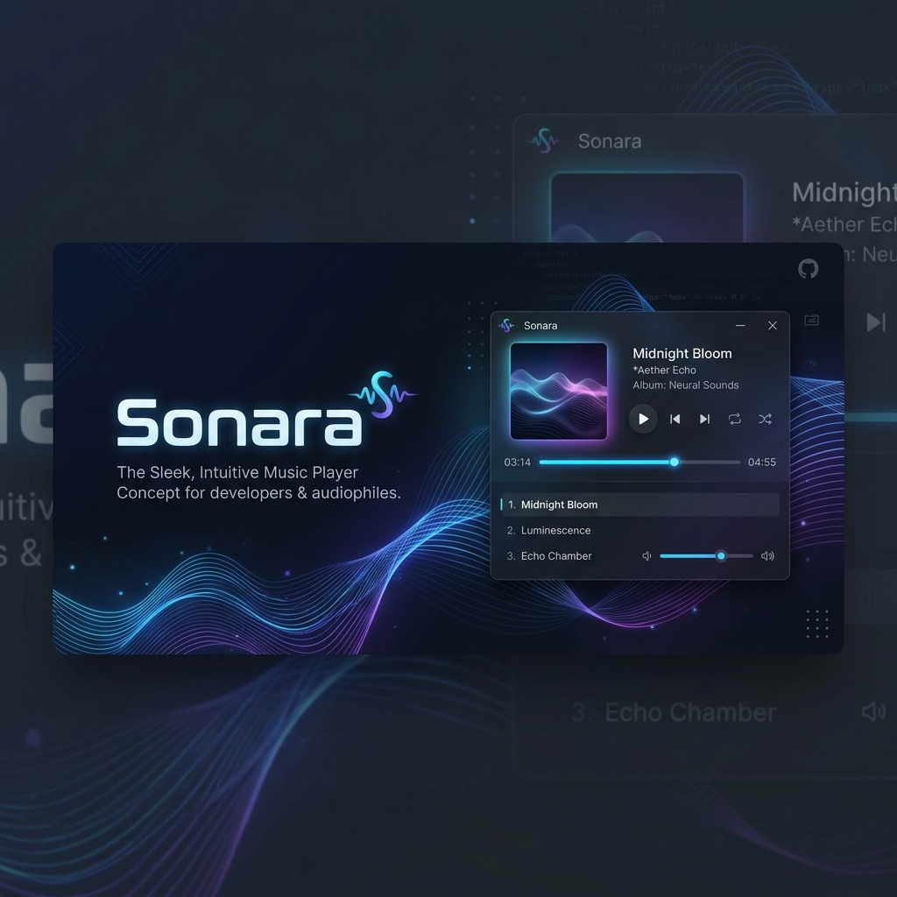
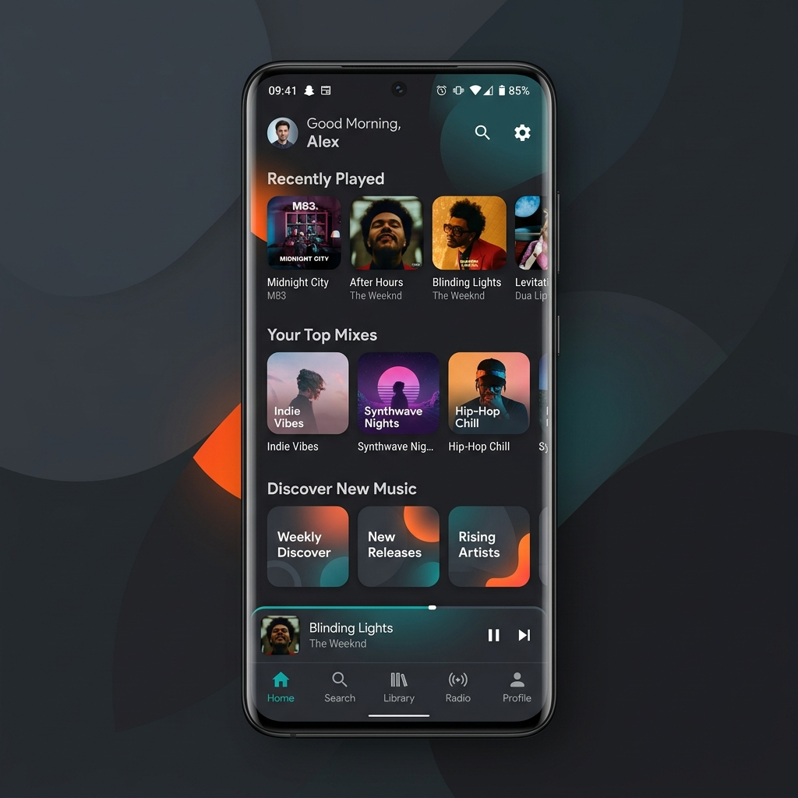
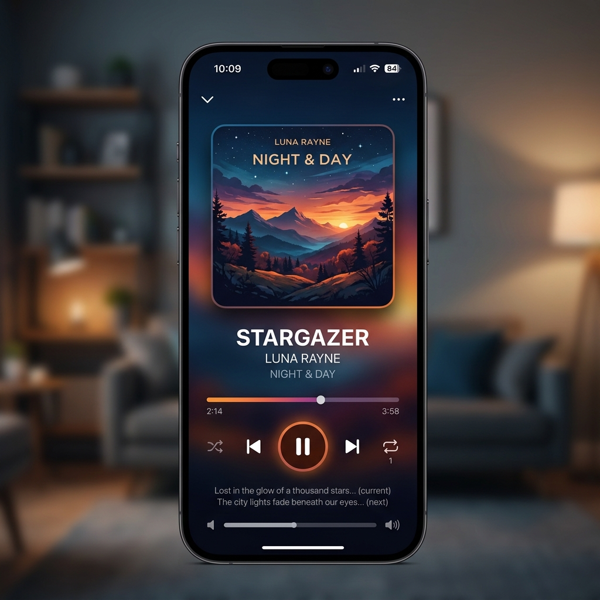
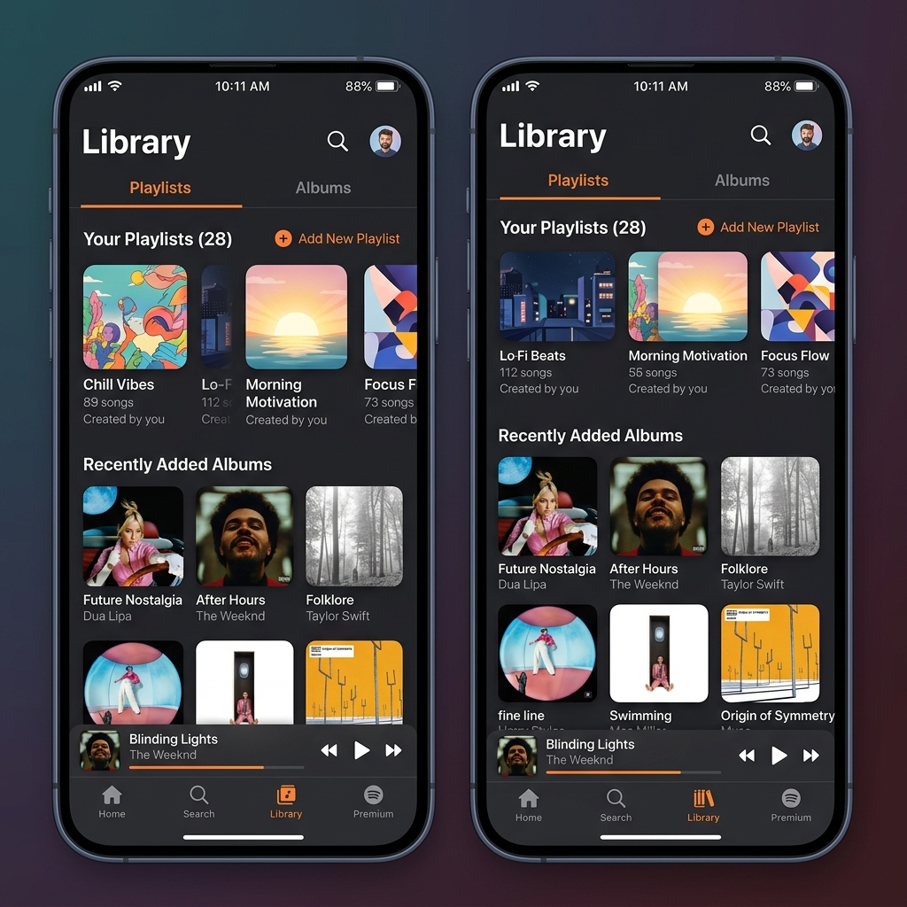
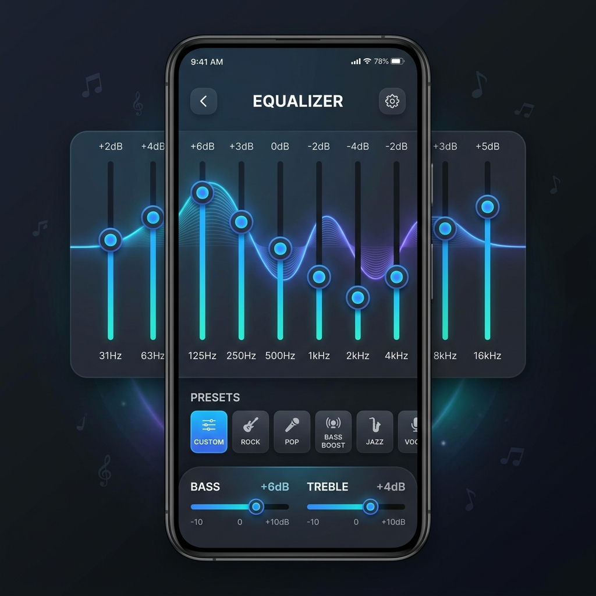

# 
Sonara

  

 

  <strong>A strict offline-first, high-fidelity music streaming platform built for privacy and performance.</strong>

 

  <a href="#features">Features</a> •
  <a href="#architecture-overview">Architecture</a> •
  <a href="#installation-guide">Installation</a> •
  <a href="docs/api/api.md">API Docs</a> •
  <a href="docs/product_introduction.md">About</a>

---

## ?? Why Sonara Exists
Sonara was built to reclaim ownership of local music libraries. In an era where streaming services dynamically delete tracks and compress audio, Sonara provides a pristine, high-fidelity engine to manage, sync, and play local audio files (MP3, FLAC, WAV) with zero telemetry or tracking.

## ? Features
- **Material You Design**: The UI dynamically inherits colors from the current playing album art or system wallpaper.
- **Strict Offline Playback**: Engineered explicitly for local storage without buffering or internet dependencies.
- **Advanced Equalizer**: 10-band precision audio equalizer with custom profiles.
- **Background Sync Engine**: Seamlessly reconciles playlist metadata and downloads via WorkManager.
- **Play Integrity Security**: Tamper-proof validation ensuring the application's bytecode is unaltered.

## ?? Screenshots

  
  
  
  

## ?? Architecture Overview
Sonara utilizes the modern Android technology stack. Following Clean Architecture principles, the app is modular, testable, and highly performant. View our [Full Architecture Documentation](docs/architecture/architecture.md).

### Tech Stack
- **Language**: Kotlin 1.9+
- **UI Toolkit**: Jetpack Compose & Material 3
- **Media Engine**: AndroidX Media3 (ExoPlayer)
- **Dependency Injection**: Dagger Hilt
- **Local Persistence**: Room Database & DataStore
- **Background Tasks**: WorkManager
- **Security**: Jetpack Security Crypto & Google Play Integrity

## ?? Project Structure
\\\
Sonara/
+-- android/app/      # Main Android Application Module
+-- docs/             # Technical Documentation & Assets
+-- release/          # Compiled APKs and Checksums
+-- src/              # Vercel React Landing Page (Frontend)
\\\

## ?? Security Features
Sonara implements military-grade local security:
- **EncryptedSharedPreferences** via AES256_SIV for user preferences.
- **Dynamic KeyStore Encryption** using AES256_GCM for database integrity.
- **Play Integrity Token Verification** to prevent sideload tampering.

## ?? Installation Guide
1. Go to the [Releases](../../releases) tab.
2. Download the latest \sonara-release.apk\.
3. Transfer to your Android device and install (requires Android 8.0+).

## ?? Build Instructions
To build Sonara from source:
\\\ash
git clone https://github.com/yourusername/sonara.git
cd sonara/android
./gradlew assembleDebug
\\\

## ?? CI/CD
Sonara uses GitHub Actions for continuous integration.
- \uild.yml\: Compiles the project and runs unit tests.
- \lint.yml\: Enforces detekt and ktlint rules.
- \
elease.yml\: Generates the signed AAB/APK artifacts on tag.

## ?? Documentation
- [Architecture](docs/architecture/architecture.md)
- [Deployment](docs/deployment/deployment.md)
- [API Reference](docs/api/api.md)

## ?? Roadmap
- [ ] Desktop Application (Kotlin Multiplatform)
- [ ] Direct Wi-Fi P2P Library Sync
- [ ] Last.fm Scrobbling Integration

## ?? Contributing
Please read [CONTRIBUTING.md](CONTRIBUTING.md) for details on our code of conduct, and the process for submitting pull requests to us.

## ?? License
This project is licensed under the MIT License - see the [LICENSE](LICENSE) file for details.

## ?? Contact
Tamanash Chakraborty - [@chakr](https://github.com/chakr)
Project Link: [https://github.com/chakr/sonara](https://github.com/chakr/sonara)
